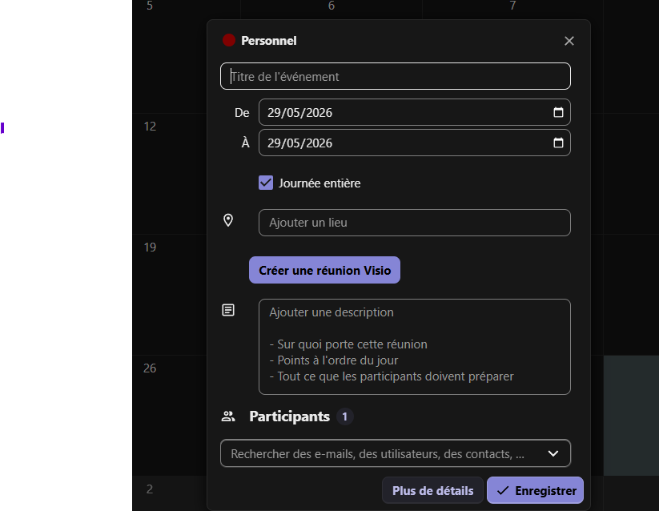

# Calendar Visio Add-on


A Nextcloud Calendar plugin that adds a **"Create Visio meeting"** button directly into the event editor. One click calls the Visio (Meet) External API, generates a meeting room, and inserts the join link into the event location field.


---

## Features

- 🎥 **One-click meeting creation** — button injected into the Calendar event editor (both full and simple edit views)
- 🔗 **Auto-fill location** — the join URL is inserted into the event location and Vue reactivity is triggered
- 🔔 **Toast notifications** — success/error feedback using Nextcloud's native toast system
- 🌐 **i18n** — English and French included; Transifex-compatible structure
- ⚙️ **Admin settings** — configure API URL and OAuth2 credentials from the Nextcloud admin panel

---

## Requirements

| Component | Version |
|-----------|---------|
| Nextcloud | 29 – 32 |
| PHP       | 8.1 – 8.5 |
| Visio (Meet) instance | External API v1.0 enabled |

---

## Installation (Nextcloud App Store)

> ⚠️ Not yet published. For manual installation, see below.

### Manual installation

#### From the Git repository

```bash
cd /var/www/html/custom_apps
git clone https://github.com/soprasteria/calendar-visio-addon.git calendar_visio_addon
# Adjust the ownership before enabling the app
chown -R www-data:www-data /var/www/html/custom_apps/calendar_visio_addon
# Enable the app
php /var/www/html/occ app:enable calendar_visio_addon
```

#### From a GitHub release

You can download a packaged release instead of cloning the repository. Run these
commands from the Nextcloud `custom_apps` directory:

```bash
cd /var/www/html/custom_apps

RELEASE_VERSION=1.0.0
ARCHIVE="calendar_visio_addon-${RELEASE_VERSION}.tar.gz"
RELEASE_URL="https://github.com/soprasteria/calendar-visio-addon/releases/download/v${RELEASE_VERSION}/${ARCHIVE}"
# Download the release
curl -fL "$RELEASE_URL" -o "$ARCHIVE"
# Extract the .tar.gz archive
tar -xzf "$ARCHIVE"
rm "$ARCHIVE"
# Adjust the ownership before enabling the app
chown -R www-data:www-data /var/www/html/custom_apps/calendar_visio_addon
# Enable the app
php /var/www/html/occ app:enable calendar_visio_addon
```

---

## Configuration Nextcloud

### Admin settings

Navigate to **Settings → Administration → Calendar Visio Add-on** and fill in:

| Field | Description |
|-------|-------------|
| Visio API Base URL | Base URL of the Meet instance (e.g. `https://visio.example.org`) — no trailing `/api` |
| OAuth2 Client ID | `client_id` registered in Meet's Django Admin |
| OAuth2 Client Secret | `client_secret` for the OAuth2 application |

### Environment variables (alternative / override)

```bash
VISIO_API_URL=https://visio.example.org
VISIO_CLIENT_ID=nextcloud-addon
VISIO_CLIENT_SECRET=your-secret
```

Environment variables take priority over the admin settings.

---

## How it works

```
User clicks "Create Visio meeting"
    │
    ▼
POST /apps/calendar_visio_addon/api/v1/meeting/create
    │
    ▼
MeetingController → VisioMeetingService
    │
    ├─ Step 1: POST {api_url}/external-api/v1.0/application/token/
    │          body: { client_id, client_secret, grant_type, scope: user_email }
    │          → access_token (JWT)
    │
    └─ Step 2: POST {api_url}/external-api/v1.0/rooms/
               header: Authorization: Bearer {access_token}
               body: { name: "Réunion Nextcloud" }
               → { url, slug, ... }
    │
    ▼
JS fills location field with the join URL
```

---

## Development

### Prerequisites

- PHP 8.1+, Composer
- Node.js 24+, npm 11+

### Setup

```bash
composer install
npm install
```

### Commands

```bash
# PHP
composer run cs:check   # code style (dry-run)
composer run psalm      # static analysis
composer run test:unit  # PHPUnit tests


```

---

## Project structure

```
calendar-visio-addon/
├── appinfo/           # Nextcloud app metadata (info.xml, routes.php)
├── css/               # Styles
├── img/               # Icons (app.svg)
├── js/                # Frontend scripts (served directly — no dist/ subdirectory)
│   ├── calendar-visio-plugin.js   # Main plugin injected on every Calendar page
│   └── admin-settings.js          # Admin settings form handler
├── l10n/              # Translations (en, fr)
├── lib/               # PHP backend
│   ├── AppInfo/       # Application bootstrap
│   ├── Controller/    # MeetingController, SettingsController
│   ├── Service/       # VisioApiService, VisioMeetingService
│   └── Settings/      # AdminSection, AdminSettings
├── templates/         # PHP templates (admin.php)
└── tests/             # PHPUnit unit tests
```

---

## Copyright & License

Copyright 2026, [Sopra Steria France](https://www.soprasteria.fr/)

This program is licensed under GNU Affero General Public License as
published by the Free Software Foundation, either version 3 of the
License, or (at your option) any later version. Please read the
[LICENSE](LICENSE) file for more information.

SPDX-License-Identifier: AGPL-3.0-or-later

